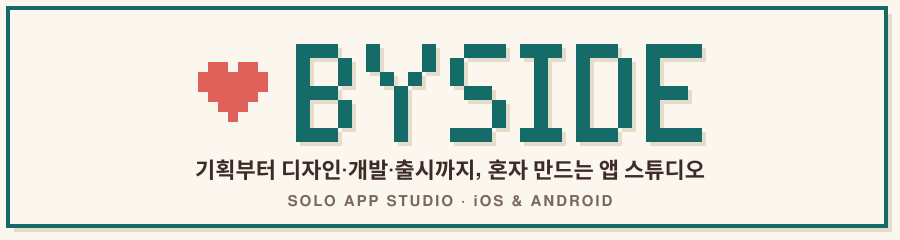

<picture>
  <source media="(prefers-color-scheme: dark)" srcset="./banner-dark.svg">
  
</picture>

### 안녕하세요, 1인 앱 스튜디오 **내곁의(BySide)** 예요 👋

꼭 필요한 일 하나를 편하게 해 주는 작은 앱을 만들어요.
매일 손이 가고 오래 곁에 두고 싶은 앱이 되도록 하나씩 다듬고 있어요.

Hi! I'm a solo app studio making small, everyday apps for iOS & Android.

---

### 🧩 만든 앱

<table>
  <tr>
    <td align="center" width="25%">
       
      <b>내곁의 디데이</b> 
      사진으로 꾸미는 디데이 음력 생신까지 먼저 알림  
      
    </td>
    <td align="center" width="25%">
       
      <b>내곁의 노노그램</b> 
      숫자를 따라 칠하면 픽셀 그림이 피어나요  
      
    </td>
    <td align="center" width="25%">
       
      <b>내곁의 스도쿠</b> 
      하루 한 판 오늘의 퍼즐 브론즈부터 마스터까지  
      
    </td>
    <td align="center" width="25%">
       
      <b>내곁의 여비</b> 
      여행 환율 계산기와 가계부 인터넷 없이도 OK  
      
    </td>
  </tr>
</table>

---

### 🌱 잔디밭

  <picture>
    <source media="(prefers-color-scheme: dark)" srcset="https://streak-stats.demolab.com?user=Boksday&theme=dark&hide_border=true&background=151817&ring=7FD1C9&fire=F07A72&currStreakLabel=7FD1C9&locale=ko">
    
  </picture>

  <picture>
    <source media="(prefers-color-scheme: dark)" srcset="https://github-readme-activity-graph.vercel.app/graph?username=Boksday&bg_color=151817&color=C9BDB5&line=7FD1C9&point=F07A72&area=true&area_color=7FD1C9&hide_border=true&custom_title=최근%2031일%20기여">
    
  </picture>

  <picture>
    <source media="(prefers-color-scheme: dark)" srcset="https://raw.githubusercontent.com/Boksday/Boksday/output/snake-dark.svg">
    
  </picture>

---

### 🛠 이렇게 만들어요

  
  
  
  

- 🌏 모든 앱 5개 언어 — 한국어 · English · 日本語 · 简体中文 · 繁體中文
- 🔒 회원가입 없이, 기록은 내 폰에만
- 🎨 홈 화면 위젯과 다크 모드까지 챙겨요

---

  <a href="https://boksday.github.io/">🏠 boksday.github.io</a>

