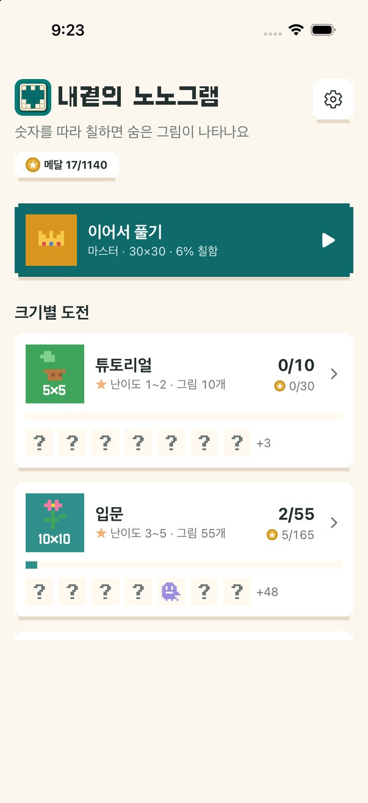
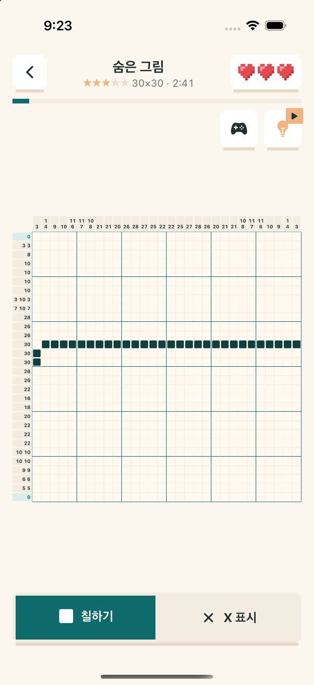

<picture>
  <source media="(prefers-color-scheme: dark)" srcset="./banner-dark.svg">
  
</picture>

  
  

## 👋 About

안녕하세요, 1인 앱 스튜디오 **내곁의(BySide)** 예요.
**꼭 필요한 일 하나를 편하게 해 주는 작은 앱**을 만들어요. 아이디어부터 화면 디자인, 개발, 스토어 출시와 운영까지 혼자 다 해요.

Solo app studio building small everyday apps for iOS & Android — from idea, design and code to store release.

<table>
  <tr>
    <td align="center" width="25%"><h3>4</h3>만든 앱</td>
    <td align="center" width="25%"><h3>5개 언어</h3>한 · 영 · 일 · 简 · 繁</td>
    <td align="center" width="25%"><h3>400+</h3>커밋</td>
    <td align="center" width="25%"><h3>iOS · Android</h3>하나의 코드로 두 플랫폼</td>
  </tr>
</table>

## 📱 Projects

###  내곁의 디데이 &nbsp;

좋아하는 사진으로 디데이를 꾸미고, 음력 생신·100일 기념일까지 그날이 오기 전에 먼저 알려 주는 디데이 앱.

  
  
  
  

- **음력 → 양력 자동 변환**: 음력 생신을 해마다 양력 날짜로 다시 계산해 알림을 맞춰요
- **홈·잠금 화면 위젯**: iOS는 `expo-widgets`, Android는 `react-native-android-widget`으로 각각 만들었어요
- **카드 이미지 공유**, 사진 자르기, 끌어서 순서 바꾸기, 인앱 결제, 정확한 시각 알림(Kotlin 네이티브 모듈)
- `Expo` `React Native` `TypeScript` `Reanimated` `expo-widgets` `expo-iap` `AdMob`

[소개](https://boksday.github.io/dday/) · [Google Play](https://play.google.com/store/apps/details?id=com.naegyeot.dday) · [고객 지원](https://boksday.github.io/dday/support/)

---

###  내곁의 노노그램 &nbsp;

숫자 단서를 따라 칸을 칠하면 숨은 픽셀 그림이 색으로 피어나는 그림 로직 퍼즐.

  
  

- **퍼즐 354개 자동 생성 파이프라인**: 픽셀 그림 → 색 정리 → 줄 풀이로 정답이 하나뿐인지 검증 → 난이도 별점까지 스크립트로 만들어요
- **앱 업데이트 없이 새 퍼즐**: 퍼즐을 GitHub Pages에서 받아 와서 계속 늘어나요
- **30×30도 부드럽게**: 줄 단위 메모이제이션으로 큰 판에서도 칠하기가 바로 반응해요. 확대·방향 패드·끌어 칠하기 지원
- `Expo` `React Native` `TypeScript` `Reanimated` `Gesture Handler` `Python` `AdMob 보상형 광고`

[소개](https://boksday.github.io/nonogram/) · [고객 지원](https://boksday.github.io/nonogram/support/)

---

###  내곁의 스도쿠 &nbsp;

모두에게 같은 오늘의 퍼즐을 풀고, 브론즈에서 마스터까지 티어를 올리는 스도쿠.

  
  
  
  

- **오늘의 퍼즐**: 날짜를 시드로 퍼즐을 만들어 모두가 같은 판을 풀어요
- **6단계 티어**, 기록 통계, Game Center 순위표·업적
- **SwiftUI 위젯**으로 오늘의 퍼즐 상태·연속 기록·티어를 홈 화면에서
- `Expo` `React Native` `TypeScript` `SwiftUI` `Game Center` `AdMob`

[소개](https://boksday.github.io/sudoku/) · [고객 지원](https://boksday.github.io/sudoku/support/)

---

###  내곁의 여비 &nbsp;

여행지 돈을 원화로 바로 계산하고, 쓴 돈을 한 번에 기록하는 여행 환율 계산기 겸 가계부.

  
  
  
  

- **인터넷 없이도 계산**: 환율은 하루 한 번(약 2KB) 받고, 오프라인이면 마지막 환율을 써요
- **현금·카드 지출 기록**과 남은 현금 한눈에 보기
- **SwiftUI 위젯 2종**: 환율 위젯과 여행 지출 위젯
- `Expo` `React Native` `TypeScript` `SwiftUI` `WidgetKit`

[소개](https://boksday.github.io/trip/) · [고객 지원](https://boksday.github.io/trip/support/)

## 🛠 Tech Stack

  
  
  
  
  
  
  
  
  

**이렇게 만들어요**
- 🌏 모든 앱을 처음부터 5개 언어로 — 앱, 스토어 문구, 웹페이지까지
- 🔒 회원가입 없이, 기록은 내 폰에만
- 🎨 다크 모드, 위젯, 큰 글씨와 화면 낭독기까지 챙겨요
- 🧪 출시 전 모든 기기에서 Release 빌드로 통합 테스트

## 🌱 Contributions

<picture>
  <source media="(prefers-color-scheme: dark)" srcset="https://raw.githubusercontent.com/Boksday/Boksday/output/stats-dark.svg">
  
</picture>

<picture>
  <source media="(prefers-color-scheme: dark)" srcset="https://raw.githubusercontent.com/Boksday/Boksday/output/snake-dark.svg">
  
</picture>
